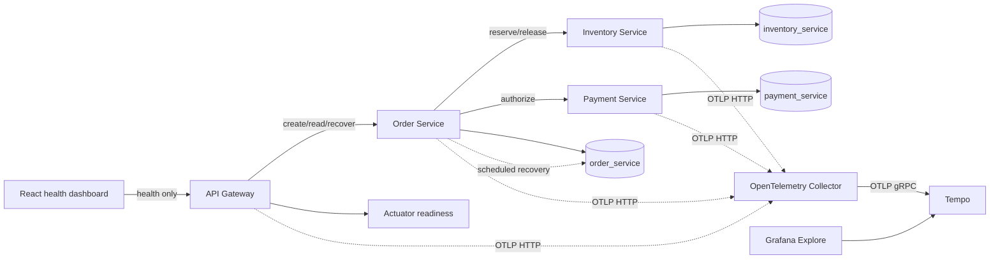
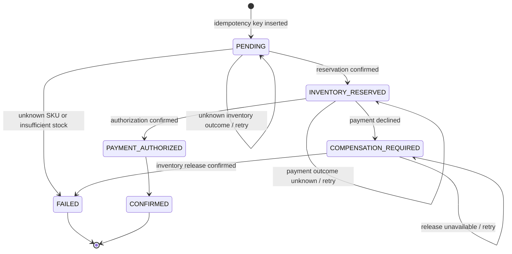

# Architecture

## Runnable order workflow

The current sample is a synchronous, persisted saga across separate Spring Boot services. PostgreSQL is one Compose service, with service-owned Flyway schemas:

The gateway, Tempo query API, and Grafana UI are published only on loopback. Internal service ports, Collector receivers, Collector health, and PostgreSQL are available only on the Compose network. The dashboard reports only gateway health and does not create sample business activity.

## Order state machine

The order row is the durable saga cursor. Conditional updates require the expected current state, which prevents a stale worker from overwriting a terminal result.

`FAILED` after payment decline retains `failureReason: PAYMENT_DECLINED`, the reservation ID, and `inventoryReleased: true`. If release is not confirmed, the order remains `COMPENSATION_REQUIRED`; it never reports a completed/failed payment saga as compensated without an Inventory response. Unknown SKU and insufficient stock produce `FAILED` without a reservation ID. `CONFIRMED` and `FAILED` are terminal.

`PAYMENT_AUTHORIZED` is committed before the final `CONFIRMED` transition. If the Order Service stops between them, recovery can safely finish the transition without another payment effect.

## Service contracts

### Gateway routes

- `GET /api/v1/health` is the versioned gateway health contract. `/actuator/health` is readiness, not the product API.
- `GET /api/v1/inventory/{sku}` proxies the database-backed inventory read.
- `POST /api/v1/orders` requires `Idempotency-Key` and accepts `{ "sku": "SKU-ALPHA", "quantity": 2 }`.
- `GET /api/v1/orders/{id}` reads an order.
- `POST /api/v1/orders/{id}/recover` makes one manual recovery attempt; Order Service permits it only in the `local` profile.

The order key syntax is `[A-Za-z0-9._:-]{1,128}`. Its first request persists the key, SKU, and quantity before downstream calls. An exact retry returns the stored order and does not restart synchronous work; a payload mismatch returns 409. A unique index plus `INSERT ... ON CONFLICT` arbitrates simultaneous first requests. The UUID order ID is also the Inventory idempotency key and the Payment `Idempotency-Key`.

Order request validation uses SKU syntax `[A-Z0-9][A-Z0-9-]{0,31}` and quantity 1–1000. Invalid input returns 400 before inserting the order. Unknown SKU returns 404 with a stored `FAILED` order; insufficient stock returns 409 with a stored `FAILED` order. Confirmed orders return 201. Payment decline returns 402 only after inventory release succeeds. Dependency/outcome uncertainty or pending compensation returns 503 with the durable order state in the body.

### Inventory Service

- `GET /internal/v1/inventory/{sku}` returns the PostgreSQL quantity.
- `POST /internal/v1/inventory/reservations` accepts `{ "orderId": "…", "sku": "…", "quantity": 2 }`.
- `POST /internal/v1/inventory/reservations/{orderId}/release` is the idempotent compensation operation.

Reservation takes a row lock, checks an existing order reservation, decrements the item, and inserts one reservation in a local DB transaction. Release locks the item/reservation, increments stock only when `released_at` is null, and records release in the same transaction. Repeated release returns the existing released reservation without restoring stock again. A conflicting reserve payload for the same order is rejected.

### Payment Service

`POST /internal/v1/payments/authorizations` requires `Idempotency-Key` and accepts `{ "orderId": "…", "amountMinor": 200 }`. The deterministic local simulator persists `AUTHORIZED` or `DECLINED` attempts in `payment_service`. Repeating the same key, order, and amount returns the same attempt. Reusing a key with different details returns 409. The order service passes quantity × 100 synthetic minor units; this is a simulator value, not a product price or an external payment. No card or bank details are accepted.

## Transaction boundaries, idempotency, and recovery

There is no distributed transaction. Each service commits only its own schema:

1. Order Service inserts a `PENDING` row with the idempotency key.
2. Inventory Service commits stock decrement and reservation together; the Order Service then stores `INVENTORY_RESERVED` and the returned reservation ID.
3. Payment Service commits one attempt per idempotency key; the order stores `PAYMENT_AUTHORIZED` and then `CONFIRMED`.
4. If payment is declined, Order Service persists `COMPENSATION_REQUIRED` before asking Inventory to release. Only a confirmed release transitions the order to `FAILED` with `inventoryReleased=true`.

HTTP calls use 1-second connection and 2-second response timeouts. Operations that can mutate remote state are never retried with a fresh identity: recovery resends the same order UUID/idempotency key. A timeout is treated as an unknown result unless the caller received a controlled pre-mutation failure response. `PENDING` does not claim whether an inventory reservation exists; `INVENTORY_RESERVED` means the order has a confirmed reservation ID. A timed-out payment may already be durable, so a retry reads the same stored authorization/decline.

Order state changes use expected-state compare-and-set updates. Scheduled recovery scans due orders every five seconds, waits 15 seconds before a row is eligible again, and stops automatic retries after ten same-state failed attempts. Exhaustion is recorded as `AUTOMATIC_RETRIES_EXHAUSTED`; local manual recovery remains available. The recovery process is in the Order Service and needs no broker or workflow engine. The API request and recovery worker can race, but Inventory reservation/release and Payment authorization are idempotent, and terminal states cannot be overwritten.

These guarantees reduce duplicate effects and make uncertain work visible; they are not exactly-once execution. There is no outbox, cross-service transaction, automated refund of an already authorized payment, cancellation API, payment capture/settlement, distributed lock, or production-grade reconciliation dashboard. In the implemented simulator, a decline is definitive and no authorization is created. A production provider would require additional refund/void semantics, credential handling, and review of idempotency retention.

If Payment Service reports an idempotency-key/payload conflict, the order stays `INVENTORY_RESERVED` with `recoveryError: MANUAL_REVIEW_REQUIRED`. The worker does not release inventory in this case because the conflicting durable key could represent an authorization; automatic compensation without resolving that ambiguity could leave a payment without a held order.

## Distributed traces

Each service image attaches the same pinned OpenTelemetry Java agent (`2.30.0`) to the pinned Java 21 runtime. The agent creates incoming Spring MVC/servlet server spans and outgoing HTTP client spans. Existing service calls use Spring `RestClient` with `SimpleClientHttpRequestFactory`; the agent instruments those HTTP edges. The application does not add a second HTTP server/client instrumentation layer. OpenTelemetry API `1.64.0` adds only business spans that automatic HTTP instrumentation cannot infer: `order.create`, `order.recovery`, `order.recovery.worker`, `inventory.reserve`, `inventory.release`, and `payment.authorize`.

Compose sets `OTEL_PROPAGATORS=tracecontext`, so a caller's W3C `traceparent` (and `tracestate` on HTTP edges) is extracted at the gateway and injected on each downstream request. Baggage is not enabled. Local sampling is parent-based and always on to keep the deterministic demo queryable. `TRACEFORGE_TRACING_ENABLED=false` sets `OTEL_JAVAAGENT_ENABLED=false`; business requests and recovery still run, without exported spans.

HTTP spans include `service.name`, `http.route`, method, and response status. Business spans add order state/outcome, allowlisted failure/recovery codes, `order.id`, and reservation/authorization operation IDs. These high-cardinality IDs are span attributes only and are never metric labels. We do not add SKU, payment amount, payment details, request/response bodies, or authorization secrets to custom span attributes. Exception events contain exception type without a free-form message on custom spans. The Java agent's normal HTTP instrumentation does not enable header or body capture. Metrics and logs exporters are disabled in this trace-only phase.

Order creation stores the originating custom order span's trace ID and span ID in private columns (`V3__add_recovery_trace_link.sql`). These columns are not included in the order API response. Scheduled recovery starts a new trace and links its `order.recovery.worker` span to the original `order.create` span. Manual recovery remains a child of its incoming HTTP trace and also links to the original order operation. The worker does not reuse a completed span as a parent. The link preserves the source trace/span IDs; it does not restore an arbitrary caller's `tracestate` or baggage into the asynchronous worker context.

The Collector receives OTLP/HTTP protobuf on the Compose network and forwards traces to Tempo over OTLP/gRPC. The upstream Collector and Tempo binaries run in small Alpine wrappers because their upstream runtime images are scratch/distroless and cannot execute an in-container HTTP health probe. These wrappers retain the exact pinned upstream binaries and use `wget` only for readiness checks. Tempo uses local filesystem storage on the `traceforge-tempo-data` volume with a 24-hour block retention setting. Grafana provisions a Tempo data source for Explore. Browse `http://localhost:3000` (default local credentials in `.env.example`) or retrieve an exact trace from `http://localhost:3200/api/v2/traces/{traceId}`. The latter is also what `scripts/verify-traces.ps1` polls; HTTP health alone is not treated as proof of export.

Runtime evidence, including the caller-supplied trace ID, service set, outcome spans, recovery link, and any environmental blocker, is recorded in `TASKS.md`. On 2026-10-10, the acceptance script queried Tempo and verified the expected service spans, caller parent, failure outcomes, and recovery link; trace IDs and exact results are recorded in `TASKS.md`.

## Deterministic incident detection (Phase 4 contract)

The investigation service owns health probes, observation freshness, deterministic rule evaluation, incident persistence/deduplication, and the internal incident read API. The API Gateway exposes bounded read-only proxies for the incident list/detail and detection status. The Investigation Service writes incident records only to a dedicated `incident_service` PostgreSQL schema and obtains order observations through Order Service contracts; it never reads or writes another service's tables. Health and persisted recovery state are detection inputs; Tempo is optional supporting evidence. Missing, stale, or unavailable telemetry is not evidence that no incident exists.

The initial rules are:

- `SERVICE_NOT_READY`: open after two consecutive failed, timed-out, or non-`UP` probes of a service readiness endpoint; resolve after two consecutive `UP` probes.
- `ORDER_RECOVERY_STALLED`: detect an overdue active recovery or incomplete required compensation; resolve only when the order is terminal and required compensation is complete. Confirmed orders and ordinary business rejections, including a payment decline after successful inventory release, are not incidents.

Incidents have an `OPEN` or `RESOLVED` lifecycle. Repeated observations update one open incident per stable rule/source fingerprint; a later recurrence can create a new episode. Detection status separately reports current, partial, stale, or unavailable sources. A failed, stale, or incomplete source query must not clear or resolve an incident.

### Stage 1: Order recovery attention query

Phase 4 Stage 1 adds `GET /internal/v1/orders/attention` to Order Service. It returns a bounded page of active orders that have a persisted recovery error, require compensation, or are due for recovery. The default page size is 50 and the strict maximum is 100. Results are ordered by `(created_at, id)` and use a paired `afterCreatedAt` / `afterId` keyset cursor; the response includes `items`, the effective `limit`, and a nullable `nextCursor`.

Each item contains only `orderId`, `status`, `failureReason`, `recoveryError`, `recoveryAttempts`, `nextRecoveryAt`, `inventoryReleased`, `createdAt`, `updatedAt`, and nullable `originTraceId`. These values come from existing Order Service state. The endpoint does not return SKU, quantity, reservation/payment identifiers, amounts, request data, headers, or raw exceptions. It is served by the internal Order Service, whose port is not published to the host, and is not routed through the public gateway.

This endpoint is a read contract only. `originTraceId` can be used to look up optional trace evidence, but trace availability is not guaranteed and does not affect the business state or incident decision. See [ADR 0006](adr/0006-deterministic-incident-detection.md) for the decision and boundaries.

### Phase 4 backend integration: scheduled detection and read APIs

The Python 3.12/FastAPI `investigation-service` is part of the default Compose stack and has no published host port. On startup it applies versioned SQL migrations to its dedicated `incident_service` schema. It owns `incidents`, `health_rule_state`, `detection_cycles`, and `detection_source_state`; it does not query or mutate the Java services' schemas. PostgreSQL uses the existing shared local credentials, so the schema boundary is an application-ownership boundary, not separate database authorization.

At startup, the service launches one scheduled loop, configurable with `TRACEFORGE_DETECTION_INTERVAL_SECONDS` (default 5 seconds, bounded to 5–3600). PostgreSQL advisory locking allows only one replica to run a cycle at a time. Each cycle probes fixed `/actuator/health` routes for Gateway, Order, Inventory, and Payment, then fully reads the bounded keyset-paginated Order attention endpoint. Probe timeouts are bounded; health bodies are limited to 8 KiB; each Order page is capped at 1 MiB, pages at 500, and collected cases at 50,000. Incomplete Order pagination is marked partial/unavailable and contributes no cases, so a partial response cannot be mistaken for a complete empty result. Cycle outcomes and per-source attempted/last-success timestamps are persisted and exposed separately from incident state.

`SERVICE_NOT_READY` opens/updates after two ordered, fresh DOWN/TIMEOUT observations and resolves after two ordered, fresh UP observations. `UNKNOWN`, stale, future, or replayed health observations do not advance a streak. `ORDER_RECOVERY_STALLED` opens/updates for a recovery deadline beyond the configured grace interval, manual-review/retry-exhausted states, or explicit incomplete compensation. Confirmed orders and fully compensated payment declines are non-incidents.

Open incidents are deduplicated by a stable SHA-256 fingerprint (rule, scope, source), retain at most 20 structured evidence references, increment occurrence count on repeated observations, and can recur as a new episode after resolution. Order's `GET /internal/v1/orders/attention` exposes only active recovery cases. A second bounded private endpoint, `GET /internal/v1/orders/recovery-observations?orderIds=...`, accepts 1–100 unique known order IDs and returns explicit found cases plus `missingOrderIds`. The detector queries this endpoint only for IDs of open recovery incidents that no longer appear in the active feed. It resolves only from an explicit terminal `CONFIRMED` or `FAILED` observation with required compensation complete; missing IDs and unavailable/stale Order reads never resolve.

The Investigation Service exposes `/healthz` and database-backed `/readyz` internally, plus `/api/v1/incidents`, `/api/v1/incidents/{id}`, and `/api/v1/detection-status` on its private network address. The gateway proxies these as `GET /api/v1/incidents` (status `OPEN|RESOLVED`, limit 1–100, opaque cursor), `GET /api/v1/incidents/{id}`, and `GET /api/v1/detection-status`. Gateway-to-Investigation calls use fixed paths, timeouts, bounded response reading, and safe upstream errors. The detection status reports the latest persisted cycle and per-source `CURRENT`, `PARTIAL`, `STALE`, or `UNAVAILABLE` status. The API is read-only; the dashboard does not yet display incidents.

Tempo is not queried by the detector; trace IDs are optional evidence references and are not a detection prerequisite. On 2026-10-10, the isolated Investigation suite passed 53 tests, all four Java services passed 37 tests with the pinned JDK 21/Maven toolchain, and live detection tests verified incident opening/deduplication/resolution, failed-source non-resolution, persisted incident/freshness after Investigation restart, bounded APIs, and continued cycles with Collector stopped. Exact output, trace IDs, and remaining environmental caveats are in [TASKS.md](../TASKS.md).

The reproducible isolated suite is `scripts/test-investigation.ps1`: it runs against a dedicated `incident-test-postgres` container with a tmpfs database and a separate Compose project. The script's fixture checks database identity before applying migrations or deleting test rows. See [TASKS.md](../TASKS.md) for the recorded results and [security.md](security.md) for exposure limitations.

## Local fault controls

Compose activates the `local` profile on Order, Inventory, and Payment services. `X-TraceForge-Failure` is accepted only by those services under that profile; unsupported values are rejected. Current order scenarios are `inventory-unavailable`, `inventory-timeout-after-commit`, `payment-decline`, `payment-unavailable`, `payment-timeout-after-commit`, and `payment-decline-compensation-unavailable`. The last scenario records a decline, then makes Inventory fail before release mutation. Internal services are not published to the host.

## Data and deployment

The Compose named volume `traceforge-postgres-data` preserves the Order, Inventory, Payment, and incident schemas across container and application restarts. The named `traceforge-tempo-data` volume preserves trace WAL and blocks across container restarts; `docker compose down -v` removes both. Each Java application Dockerfile builds with `maven:3.9.16-eclipse-temurin-21`, downloads the pinned Java agent artifact at image build, and runs on `eclipse-temurin:21-jre-alpine`. `scripts/test-backend.ps1` starts the stack, executes Java backend suites in one-shot containers on the same network/toolchain, runs saga restart checks, and invokes the Tempo trace assertions. `scripts/test-investigation.ps1` uses a separate tmpfs-backed Postgres test service.

## Other planned boundaries

- **Telemetry:** distributed traces are implemented as described above. Metrics/log exporters, Loki, Prometheus, Tempo-based detection, and an observability-driven dashboard are out of scope.
- **Detection interface:** the next step is a dashboard for real incident and detection-status APIs, with explicit loading, empty, unavailable, and partial-data states. Browser workflow coverage remains future work.
- **Investigation workflows:** extend the existing FastAPI service with activation, incident reads, normalized evidence, deterministic investigations, constrained provider adapters, validated citations, and evaluation.
- **Dashboard:** consume real incident/order APIs with explicit unavailable and partial-data states; no direct database or observability queries.

See [roadmap.md](roadmap.md), [security.md](security.md), [adr/0004-persisted-payment-saga.md](adr/0004-persisted-payment-saga.md), and [adr/0005-distributed-tracing.md](adr/0005-distributed-tracing.md).
