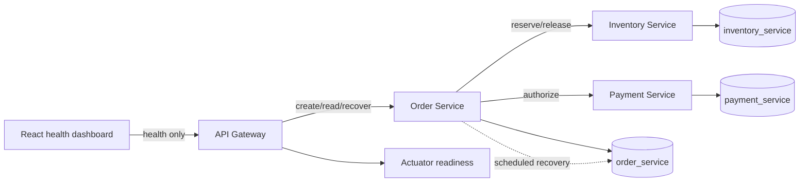
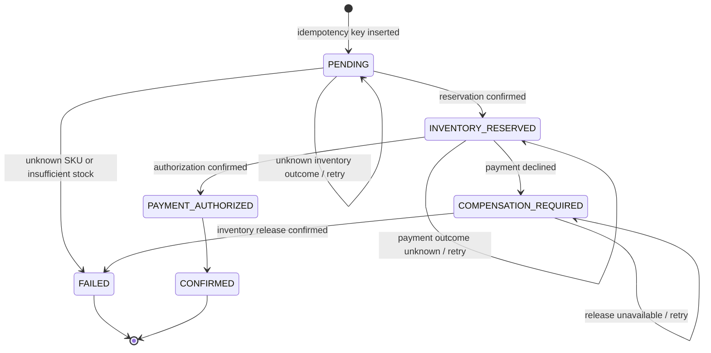

# Architecture

## Runnable order workflow

The current sample is a synchronous, persisted saga across separate Spring Boot services. PostgreSQL is one Compose service, with service-owned Flyway schemas:

Only the gateway port is published on loopback. Internal service ports and PostgreSQL are available on the Compose network. The dashboard reports only gateway health and does not create sample business activity.

## Order state machine

The order row is the durable saga cursor. Conditional updates require the expected current state, which prevents a stale worker from overwriting a terminal result.

`FAILED` after payment decline retains `failureReason: PAYMENT_DECLINED`, the reservation ID, and `inventoryReleased: true`. If release is not confirmed, the order remains `COMPENSATION_REQUIRED`; it never reports a completed/failed payment saga as compensated without an Inventory response. Unknown SKU and insufficient stock produce `FAILED` without a reservation ID. `CONFIRMED` and `FAILED` are terminal.

`PAYMENT_AUTHORIZED` is committed before the final `CONFIRMED` transition. If the Order Service stops between them, recovery can safely finish the transition without another payment effect.

## Service contracts

### Gateway routes

- `GET /api/v1/health` is the versioned gateway health contract. `/actuator/health` is readiness, not the product API.
- `GET /api/v1/inventory/{sku}` proxies the database-backed inventory read.
- `POST /api/v1/orders` requires `Idempotency-Key` and accepts `{ "sku": "SKU-ALPHA", "quantity": 2 }`.
- `GET /api/v1/orders/{id}` reads an order.
- `POST /api/v1/orders/{id}/recover` makes one manual recovery attempt; Order Service permits it only in the `local` profile.

The order key syntax is `[A-Za-z0-9._:-]{1,128}`. Its first request persists the key, SKU, and quantity before downstream calls. An exact retry returns the stored order and does not restart synchronous work; a payload mismatch returns 409. A unique index plus `INSERT ... ON CONFLICT` arbitrates simultaneous first requests. The UUID order ID is also the Inventory idempotency key and the Payment `Idempotency-Key`.

Order request validation uses SKU syntax `[A-Z0-9][A-Z0-9-]{0,31}` and quantity 1–1000. Invalid input returns 400 before inserting the order. Unknown SKU returns 404 with a stored `FAILED` order; insufficient stock returns 409 with a stored `FAILED` order. Confirmed orders return 201. Payment decline returns 402 only after inventory release succeeds. Dependency/outcome uncertainty or pending compensation returns 503 with the durable order state in the body.

### Inventory Service

- `GET /internal/v1/inventory/{sku}` returns the PostgreSQL quantity.
- `POST /internal/v1/inventory/reservations` accepts `{ "orderId": "…", "sku": "…", "quantity": 2 }`.
- `POST /internal/v1/inventory/reservations/{orderId}/release` is the idempotent compensation operation.

Reservation takes a row lock, checks an existing order reservation, decrements the item, and inserts one reservation in a local DB transaction. Release locks the item/reservation, increments stock only when `released_at` is null, and records release in the same transaction. Repeated release returns the existing released reservation without restoring stock again. A conflicting reserve payload for the same order is rejected.

### Payment Service

`POST /internal/v1/payments/authorizations` requires `Idempotency-Key` and accepts `{ "orderId": "…", "amountMinor": 200 }`. The deterministic local simulator persists `AUTHORIZED` or `DECLINED` attempts in `payment_service`. Repeating the same key, order, and amount returns the same attempt. Reusing a key with different details returns 409. The order service passes quantity × 100 synthetic minor units; this is a simulator value, not a product price or an external payment. No card or bank details are accepted.

## Transaction boundaries, idempotency, and recovery

There is no distributed transaction. Each service commits only its own schema:

1. Order Service inserts a `PENDING` row with the idempotency key.
2. Inventory Service commits stock decrement and reservation together; the Order Service then stores `INVENTORY_RESERVED` and the returned reservation ID.
3. Payment Service commits one attempt per idempotency key; the order stores `PAYMENT_AUTHORIZED` and then `CONFIRMED`.
4. If payment is declined, Order Service persists `COMPENSATION_REQUIRED` before asking Inventory to release. Only a confirmed release transitions the order to `FAILED` with `inventoryReleased=true`.

HTTP calls use 1-second connection and 2-second response timeouts. Operations that can mutate remote state are never retried with a fresh identity: recovery resends the same order UUID/idempotency key. A timeout is treated as an unknown result unless the caller received a controlled pre-mutation failure response. `PENDING` does not claim whether an inventory reservation exists; `INVENTORY_RESERVED` means the order has a confirmed reservation ID. A timed-out payment may already be durable, so a retry reads the same stored authorization/decline.

Order state changes use expected-state compare-and-set updates. Scheduled recovery scans due orders every five seconds, waits 15 seconds before a row is eligible again, and stops automatic retries after ten same-state failed attempts. Exhaustion is recorded as `AUTOMATIC_RETRIES_EXHAUSTED`; local manual recovery remains available. The recovery process is in the Order Service and needs no broker or workflow engine. The API request and recovery worker can race, but Inventory reservation/release and Payment authorization are idempotent, and terminal states cannot be overwritten.

These guarantees reduce duplicate effects and make uncertain work visible; they are not exactly-once execution. There is no outbox, cross-service transaction, automated refund of an already authorized payment, cancellation API, payment capture/settlement, distributed lock, or production-grade reconciliation dashboard. In the implemented simulator, a decline is definitive and no authorization is created. A production provider would require additional refund/void semantics, credential handling, and review of idempotency retention.

If Payment Service reports an idempotency-key/payload conflict, the order stays `INVENTORY_RESERVED` with `recoveryError: MANUAL_REVIEW_REQUIRED`. The worker does not release inventory in this case because the conflicting durable key could represent an authorization; automatic compensation without resolving that ambiguity could leave a payment without a held order.

## Local fault controls

Compose activates the `local` profile on Order, Inventory, and Payment services. `X-TraceForge-Failure` is accepted only by those services under that profile; unsupported values are rejected. Current order scenarios are `inventory-unavailable`, `inventory-timeout-after-commit`, `payment-decline`, `payment-unavailable`, `payment-timeout-after-commit`, and `payment-decline-compensation-unavailable`. The last scenario records a decline, then makes Inventory fail before release mutation. Internal services are not published to the host.

## Data and deployment

The Compose named volume `traceforge-postgres-data` preserves all three schemas across container and application restarts. `docker compose down` keeps it; `docker compose down -v` removes it. Each application Dockerfile builds with `maven:3.9.16-eclipse-temurin-21` and runs on `eclipse-temurin:21-jre-alpine`. `scripts/test-backend.ps1` starts the stack and executes all backend tests in one-shot containers on the same network and toolchain.

## Other planned boundaries

- **Telemetry:** no trace/correlation context is currently generated or propagated. The next phase is to instrument HTTP server/client spans and W3C context propagation, then add version-controlled Collector, Tempo, Loki, Prometheus, and Grafana configuration.
- **Detection:** bounded telemetry queries, deterministic rules, incident grouping/deduplication, and evidence references.
- **Investigation API:** FastAPI owns normalized evidence, deterministic investigations, constrained provider adapters, validated citations, and evaluation.
- **Dashboard:** consume real incident/order APIs with explicit unavailable and partial-data states; no direct database or observability queries.

See [roadmap.md](roadmap.md), [security.md](security.md), and [adr/0004-persisted-payment-saga.md](adr/0004-persisted-payment-saga.md).
